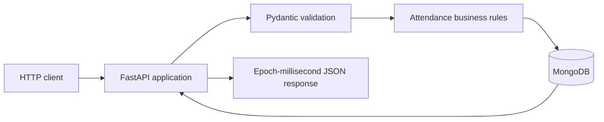
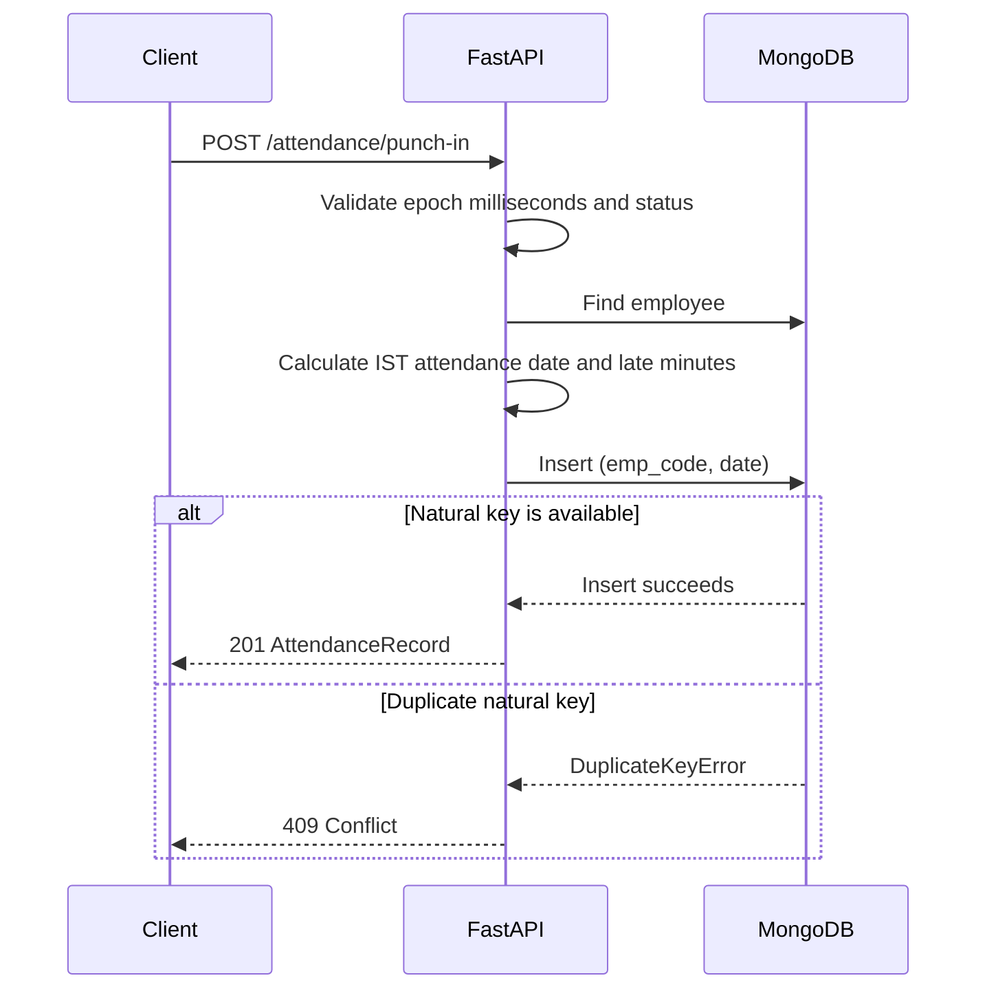
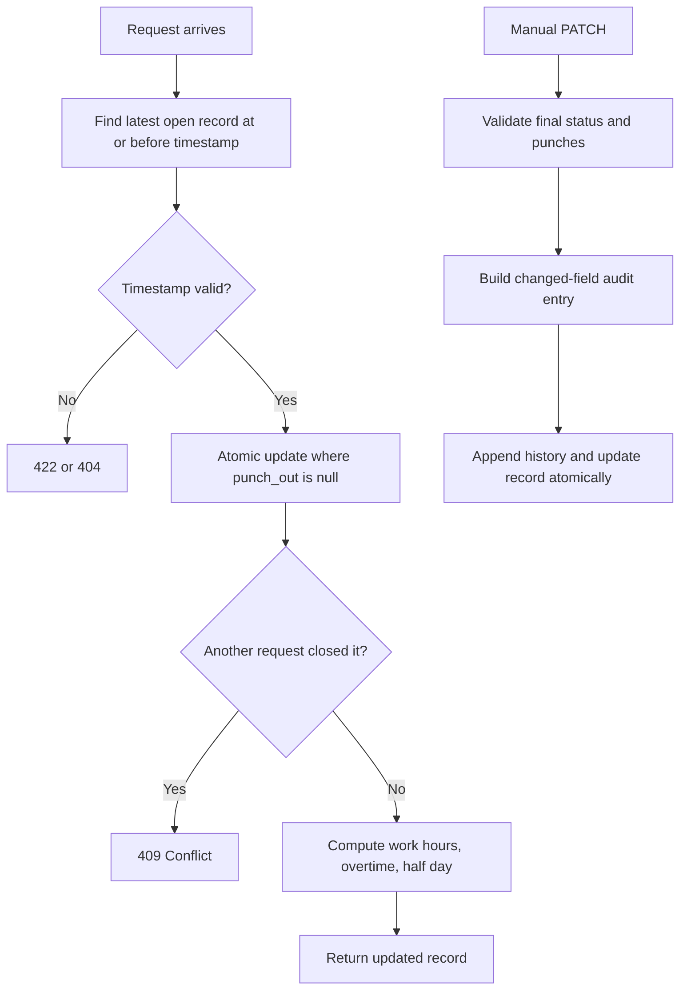

# Employee Attendance & Analytics API

This project implements the HROne technical assignment using Python, FastAPI,
Pydantic, and MongoDB. The complete application is intentionally kept in
`app/main.py`, as requested by the assignment.

## Architecture



The API keeps calendar values (`date`, `joined_on`, and shift times) as
strings, while MongoDB stores real instants as BSON datetimes. Conversion is
performed only at the HTTP boundary. This prevents accidental timezone
conversion of calendar dates and keeps response formats consistent.

## What is implemented

### Attendance

- Employee creation and paginated employee listing
- Punch-in for `PRESENT`, `WFH`, and `ON_DUTY`
- Punch-out across midnight for overnight shifts
- Manual regularization with append-only audit history
- Paginated attendance search with employee, date-range, and status filters

### Analytics

- Monthly employee attendance summary
- Monthly department summary
- Late-comers leaderboard with standard competition ranking
- Daily department trend with weekend and no-record gap days
- MongoDB explain endpoint for the supported query paths

## Endpoint map

| Area | Endpoints | Purpose |
| --- | --- | --- |
| System | `GET /health` | MongoDB readiness check |
| Employees | `POST /employees`, `GET /employees` | Create and list employees |
| Attendance | `POST /attendance/punch-in` | Open one attendance record |
| Attendance | `POST /attendance/punch-out` | Close the most recent open record |
| Attendance | `GET /attendance` | Filtered, sorted, paginated records |
| Corrections | `PATCH /attendance/{emp_code}/{date}` | Regularize a record with audit history |
| Analytics | `/analytics/...` | Monthly, department, leaderboard, and trend reports |
| Diagnostics | `GET /admin/explain/{endpoint}` | Inspect MongoDB query plans |

## Core request flows

### Punch-in



The unique `(emp_code, date)` index is the concurrency boundary. The
implementation does not rely on a check-then-insert race-prone pattern.

### Punch-out and correction



## Data model

The application uses two MongoDB collections:

| Collection | Natural key | Main responsibility |
| --- | --- | --- |
| `employees` | `emp_code` | Employee identity, department, shift, joining date |
| `attendance_logs` | `(emp_code, date)` | Punches, stored derived values, correction history |

Attendance records contain `punch_in`, `punch_out`, `work_hours`,
`late_minutes`, `overtime_minutes`, `half_day`, and an append-only `history`
array. MongoDB `_id` values are internal and never exposed through the API.

## Business-rule handling

- The IST date is derived from the punch-in instant.
- For overnight shifts, punches before the shift end belong to the previous
  shift-start date.
- The ten-minute grace period is strict: exactly ten minutes is not late.
- Overtime is reported only when it reaches thirty minutes.
- Work hours use two-decimal half-up rounding.
- Half-day status is based on rounded work hours below `4.50`.
- Monthly working days count weekdays from the employee's joining date.
- Department headcount includes employees with no attendance logs.
- Leaderboard ranks use standard competition ranking, including ties at the
  requested cutoff.

## Indexes and performance

Indexes are created idempotently during startup:

- Unique `employees.emp_code`
- `employees(department, joined_on)`
- Unique `attendance_logs(emp_code, date)`
- `attendance_logs(date, emp_code)` for sorted attendance reads and ranges
- `attendance_logs(emp_code, date, status)` for filtered attendance queries

List endpoints use database-side filtering, sorting, counting, and pagination
instead of loading the entire collection into application memory. The explain
endpoint makes query-plan inspection possible for the main read paths.

## Validation and error behavior

Invalid dates, months, statuses, pagination values, epoch values, and punch
relationships are rejected with HTTP 422. Unknown employees or records return
404. Duplicate natural keys and concurrent updates return 409. MongoDB
availability is checked by `/health`, which returns 503 when the database
cannot answer a ping.

## Important behavior

- Instants at the API boundary use epoch milliseconds.
- Calendar dates and shift times are interpreted using IST (UTC+05:30).
- Overnight shifts are assigned to the date on which the shift started.
- Late minutes, overtime, work hours, and half-day status are derived by the
  API and stored with the attendance record.
- Manual corrections append one audit entry containing only changed fields.
- MongoDB unique indexes protect employee codes, attendance natural keys, and
  concurrent punch-in requests.

## Requirements

- Python 3.11 or newer
- MongoDB 6.0 or newer

## Setup

Set these environment variables locally. A `.env` file may be used during
development, but it must not be committed:

```text
MONGO_URI=mongodb://localhost:27017
MONGO_DB=attendance_db
```

Install dependencies and start the API:

```bash
python -m venv .venv
# Windows: .venv\Scripts\activate
pip install -r requirements.txt
uvicorn app.main:app --port 8000
```

The application creates its MongoDB indexes idempotently during startup.
Interactive API documentation is available at
`http://localhost:8000/docs`.

## Verification checklist

The implementation was smoke-tested against MongoDB for:

- Database readiness and startup index creation
- Employee creation and duplicate protection
- Attendance listing and pagination
- Punch-in, punch-out, and derived values
- Manual correction and audit history
- Monthly, department, leaderboard, and trend responses
- MongoDB explain output containing an index scan

The grader should provide its own larger dataset; no sample data or credentials
are included in this repository.

## Repository documentation

- `REVIEW.md` records defects found in the starter implementation and how they
  were addressed.
- `DECISIONS.md` explains index choices, concurrency handling, leaderboard ties,
  headcount calculation, and scalability considerations.

No credentials, `.env` files, Dockerfiles, or assignment source documents are
included in this repository.
